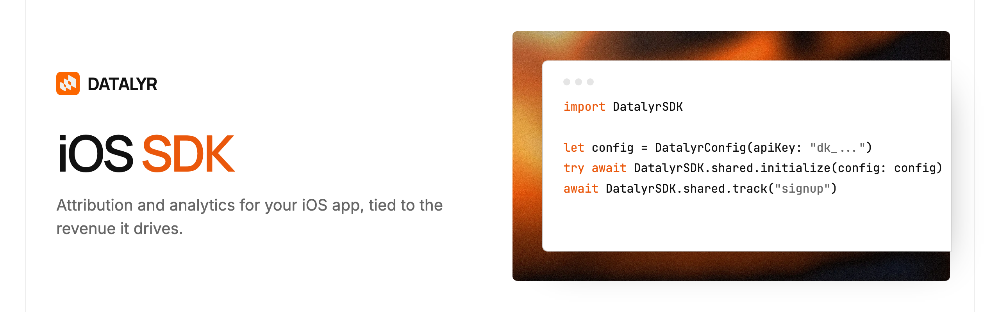

<picture>
  <source media="(prefers-color-scheme: dark)" srcset=".github/assets/banner-dark.png">
  
</picture>

<p align="center">
  <a href="https://cocoapods.org/pods/DatalyrSDK"></a>
  <a href="https://swiftpackageindex.com/datalyr/swift"></a>
  <a href="https://github.com/datalyr/swift/actions/workflows/ci.yml"></a>
  <a href="LICENSE"></a>
  <a href="https://docs.datalyr.com/sdk-reference/ios"></a>
</p>

# DATALYR iOS SDK

Track your iOS app with DATALYR and see which channel, campaign and ad drove every install and conversion.

- **Attribution.** Click IDs, UTMs, Apple Search Ads and SKAdNetwork data are captured and kept with the install.
- **One customer, every session.** Anonymous app activity joins the signed-in user when you call `identify()`.
- **Better ad signal.** Conversions reach your ad platforms with the data they need to optimize.
- **Privacy built in.** App Tracking Transparency is respected, and a privacy manifest ships with the SDK.

## Install

The SDK supports iOS 13 and later.

**Swift Package Manager:**

1. In Xcode, open **File > Add Package Dependencies**.
2. Enter `https://github.com/datalyr/swift`.
3. Select version 2.2.0.
4. Add the `DatalyrSDK` product to your app target.

Or add it to `Package.swift`:

```swift
.package(url: "https://github.com/datalyr/swift", from: "2.2.0")
```

**CocoaPods:**

```ruby
pod 'DatalyrSDK', '~> 2.2.0'
```

Run `pod install`. Then open the generated `.xcworkspace`.

Find your API key in DATALYR under **Settings → API**. The key starts with `dk_`.

## Quick start

```swift
import DatalyrSDK

// At app launch
let config = DatalyrConfig(apiKey: "dk_your_api_key")
try await DatalyrSDK.shared.initialize(config: config)

// Track an action
await DatalyrSDK.shared.track("signup_started", eventData: ["plan": "pro"])

// Tie the install to your user after sign-in
await DatalyrSDK.shared.identify("user_123", properties: ["email": "user@example.com"])

// Record a conversion with its value
await DatalyrSDK.shared.trackPurchase(value: 49.0, currency: "USD", productId: "pro_monthly")

// On logout only
await DatalyrSDK.shared.reset()
```

If your app uses RevenueCat or Superwall, connect their webhooks to DATALYR for subscription revenue. Do not send that revenue with `trackPurchase()`.

## Check it works

1. Delete the app from a test device or simulator.
2. Install and open the app.
3. In DATALYR, open **Events**.
4. Confirm that an `app_install` event arrives within 30 seconds.

If no event arrives, set `debug: true` in `DatalyrConfig`. Then read the `[Datalyr]` lines in the Xcode console.

## Set up with an AI agent

Your AI agent can install the SDK for you. Connect the agent to the DATALYR MCP server at `https://mcp.datalyr.com/mcp`. Then ask it to install tracking. See [DATALYR MCP](https://docs.datalyr.com/datalyr-mcp).

## Documentation

- [iOS SDK reference](https://docs.datalyr.com/sdk-reference/ios): every method, option and event
- [Changelog](CHANGELOG.md)
- Other SDKs: [Web](https://github.com/datalyr/web) · [React Native](https://github.com/datalyr/react-native) · [Node](https://github.com/datalyr/api)

## Support

- Bugs and feature requests: [open an issue](https://github.com/datalyr/swift/issues/new/choose)
- Security reports: see [SECURITY.md](SECURITY.md)
- Other questions: [datalyr.com](https://datalyr.com)

## License

MIT. See [LICENSE](LICENSE).
